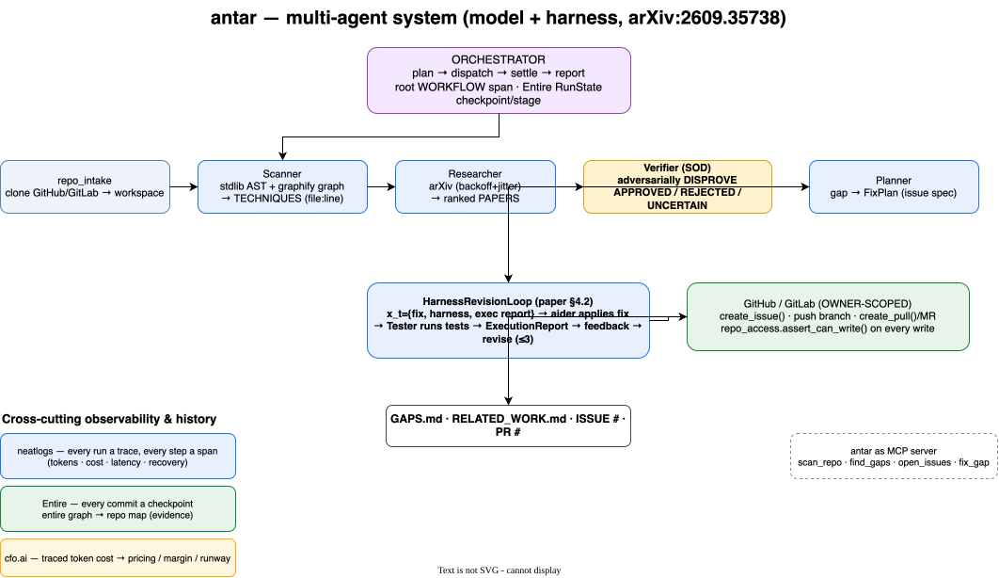
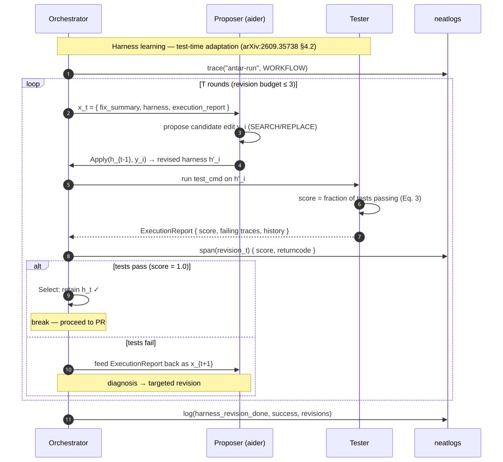

<div align="center">

# antar

### अन्तर — *the gap*

**A self-improving, multi-agent system that finds the verified gap between your ML code and the literature — then opens the issue and codes the PR.**

It reads your repo's knowledge graph, hunts arXiv, **adversarially verifies** every claim, and closes the loop by **writing and testing the fix** — adapting at test time like the research says an agent should.

`MIT` · `Python 3.11` · `neatlogs` · `Entire` · `cfo.ai` · **neatHack 2026**

[**Architecture**](#architecture) · [**The research**](#grounded-in-research) · [**Quick start**](#quick-start) · [**Docs**](#documentation)

## Demo

https://github.com/guglxni/antar/raw/main/examples/antar-demo.mp4

> 90s — the full agent loop, segregation-of-duties verification, harness-learning
> self-correction (arXiv:2609.35738), and the neatHack trio. Watch it above.

**Built in public** on X ([#neatHack](https://x.com/hashtag/neatHack)):
- [Submission](https://x.com/guglaniaaryan/status/2109710658594074713) — the quote-post
- [The story](https://x.com/guglaniaaryan/status/2109709807125217589) — the agent rejecting its own hallucinated finding

</div>

---

## Why antar exists

ML code drifts from the state of the art. Engineers ship and iterate but rarely survey the
literature — so they debug bottlenecks a paper already solved and skip standard techniques.
antar closes that gap **end-to-end**: not just "here's a paper you should read," but
**"here's the verified gap, here's the issue, and here's the tested pull request that fixes it."**

## Grounded in research

antar's coder is not a one-shot LLM call. It implements the **test-time adaptation loop** from
[*Harness Learning Enables Generalizable Test-Time Adaptation*](https://arxiv.org/abs/2609.35738)
(Zhang, Liu, Wang, Tajwar, Arora, Salakhutdinov, Khashabi, Song, Zanette — 2026).

> An agent is jointly defined by its **model** and its **harness** — the executable program that
> organizes model calls, tool use, and information flow. You improve the agent by **revising the
> harness from execution feedback**, not by touching model parameters.

antar instantiates the paper's **inner meta-learning loop** (§4.2) at inference time:

```
x_t = { fix_summary, current harness, execution report }
y_i ~ proposer(· | x_t)          # the Coder (aider) proposes a targeted fix
h'_i = Apply(h_{t-1}, y_i)       # applied to the target code
h_t  = Select(...)               # retained iff the Tester's score passes
repeat — the ExecutionReport (score, failing traces, history) feeds the next revision
```

- **Harness** = the fix being applied to the target repo.
- **Proposer** = the Coder (FOSS [aider](https://github.com/Aider-AI/aider)), equipped with a graphify code map.
- **Execution report** = the Tester's structured feedback (paper Appendix E.2) — score, failing-output tail, revision history.
- **Selection** = retain the revision iff tests pass; else the report becomes feedback for the next round.

The result is a **self-correcting agent whose improvement is itself traceable** — a neatlogs
trace showing `rev 1: FAIL → diagnosis → rev 2: PASS`. (Training the proposer with GRPO —
paper §4.3 — is future work; see LIMITATIONS.)

The full math — the revision objective, the verifier's posterior-precision model, the retry
reliability bound, and the cost/runway model — is derived in **[MATH.md](MATH.md)**.

## Architecture

<p align="center">
  
</p>

Eight specialised agents under one orchestrator, with strict **segregation of duties** —
no agent ever confirms its own work:

| Agent | Mandate | Equipped with |
|---|---|---|
| **Orchestrator** | decompose · dispatch · settle · compose | Entire RunState, root WORKFLOW span |
| **Scanner** | map the codebase, extract techniques | stdlib `ast` + **graphify** graph |
| **Researcher** | find SOTA papers per technique | arXiv API (backoff + jitter) |
| **Verifier** | **disprove** each gap (SOD gate) | adversarial-verification skill |
| **Planner** | turn a gap into an actionable spec | issue-spec writing |
| **Coder** | implement the fix (harness revision) | **aider** + graphify code map |
| **Tester** | validate, produce the execution report | pytest / lint |
| **GitHub/GitLab** | open the issue, open the PR/MR | PyGithub / python-gitlab — **owner-scoped** |

### The pipeline

<p align="center">
  
</p>

### The self-improvement loop (paper §4.2)

<p align="center">
  
</p>

### Verification = segregation of duties

<p align="center">
  
</p>

### Observability & evidence

<p align="center">
  
</p>

## Demo (live-verified)

antar ran end-to-end on [`guglxni/antar-demo-target`](https://github.com/guglxni/antar-demo-target)
(a minimal trainer deliberately missing gradient clipping):

- **Scan** detected AdamW + cosine annealing + mixed precision — and that `gradient_clipping` is **absent**.
- **Research** pulled 70 arXiv candidates via the hybrid BM25 + local-embedding + RRF pipeline.
- **Verifier** (SOD) approved **14 verified gaps** — each an arXiv-backed, evidence-linked finding.
- **Issues mode** opened **11 real GitHub issues** on the repo (owner-scoped), e.g.
  *"Implement δ-GClip (Regularized Gradient Clipping)"*, *"Add gradient clipping to trainer for
  improved convergence."*
- **PR mode** runs the harness-learning loop (arXiv:2609.35738): propose → test → revise → push → PR.
  **[PR #26](https://github.com/guglxni/antar-demo-target/pull/26) is open** — the verified
  gradient-clipping fix (`clip_grad_norm_` added, compiles), coded by the harness loop via the
  LiteLLM gateway, owner-scoped and traced.

Every run is a neatlogs trace; every commit an Entire checkpoint. A real failure→fix cycle
(verifier JSON-fence parsing, missing-vs-present gap logic) was caught in traces and fixed —
that before/after is the improvement evidence.

## Outputs

```
TECHNIQUES.md   ← what your code does now (AST + graph, file:line evidence)
PAPERS.md       ← what the literature says (arXiv, ranked)
GAPS.md         ← 🔴 critical · 🟡 improvement · 🟢 experimental — VERIFIED only
RELATED_WORK.md ← LaTeX-ready bibliography
+ a GitHub/GitLab ISSUE per verified gap, and a tested PR/MR that fixes it
```

## Quick start

```bash
git clone https://github.com/guglxni/antar.git && cd antar
uv venv && source .venv/bin/activate && uv pip install -e .
cp .env.example .env        # add NEATLOGS_API_KEY + one LLM key (BYOK)

# report only — read-only, safe on any repo
python -m antar run /path/to/ml-repo --mode report

# open one issue per verified gap (repos YOU own only)
python -m antar run guglxni/my-ml-repo --mode issues

# full loop: verify → code the fix → test → open a PR (owner-scoped, capped)
python -m antar run guglxni/my-ml-repo --mode pr --allow-pr --max-prs 1

# serve antar as an MCP server (other agents can call it)
python -m antar mcp
```

## The neatHack mandatory trio

| Tool | Role in antar |
|---|---|
| **neatlogs** | every run a trace, every step a span → failure→fix + recovery + self-improvement evidence; measured token/cost per run |
| **Entire** | git hooks checkpoint every commit; `entire graph` maps the repo during development |
| **cfo.ai** | turns the agent's *own traced token costs* into its pricing / margin / runway plan |

## Safety

- **Owner-scoped writes** — issues/PRs/MRs are opened **only** on repos the authenticated
  identity owns (GitHub: owner + push perm; GitLab: Developer+). Enforced by
  `repo_access.assert_can_write()` on every write; verified live.
- **Advisory detection** — scanning/research never modifies the target repo.
- **Verified or nothing** — unverifiable claims ship as `UNCERTAIN`, never as findings.

## Documentation

| | |
|---|---|
| **[PRD.md](PRD.md)** | problem, requirements, rubric-mapped metrics |
| **[ARCHITECTURE.md](ARCHITECTURE.md)** · **[docs/ARCHITECTURE-MULTIAGENT.md](docs/ARCHITECTURE-MULTIAGENT.md)** | system + multi-agent design |
| **[DESIGN.md](DESIGN.md)** | data model, stage contracts, error taxonomy |
| **[MATH.md](MATH.md)** | the math — incl. §8 harness learning (arXiv:2609.35738) |
| **[REFERENCES.md](REFERENCES.md)** | verified repos, clone commands, research citations |
| **[PLAN.md](PLAN.md)** · **[hackathon.md](hackathon.md)** | build plan + evidence log |

## Disclosure

A from-scratch v2 of an earlier concept ([SAGE-GitAgent](https://github.com/guglxni/SAGE-GitAgent)).
No code carried over — only design learnings. All code written within the neatHack window.

## License

MIT © 2026 Aaryan Guglani
